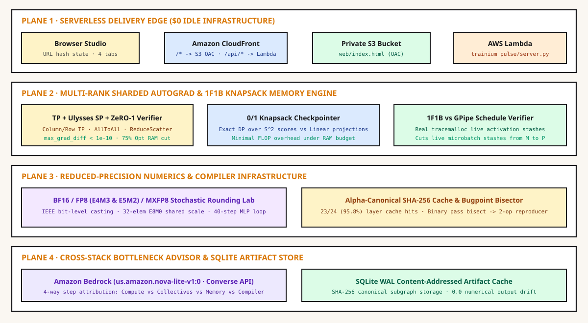

# TrainiumPulse: Distributed Training Parallelism, FP8 Stochastic Numerics & Subgraph Compiler Cache

- **Live CloudFront Application**: https://d43hwsj7yr4wk.cloudfront.net
- **Live `/api/health` Endpoint**: https://d43hwsj7yr4wk.cloudfront.net/api/health
- **GitHub Repository**: https://github.com/ritwikareddykancharla/neuron-training-parallel

TrainiumPulse is a serverless engineering workbench for distributed neural network training numerics, pipeline activation memory optimization, and canonical subgraph compiler caching, deployed serverlessly on **Amazon CloudFront + Private S3 (OAC) + AWS Lambda (serverless) + SQLite WAL + Amazon Bedrock (`us.amazon.nova-lite-v1:0`)** at `$0.00` idle cost. All tensor forward/backward passes, `tracemalloc` byte counts, IEEE/OCP bit-level quantizers, and SSA compiler passes execute directly in Python on CPU and AWS Lambda without relying on `trn1`/`trn2`/GPU instances or simulated hardware numbers.



## 01 · Problem

Scaling large language models (`Llama`, `DeepSeek` MoE) and multimodal diffusion transformers (`Flux`, `WAN` DiT) across distributed workers exposes four coupled engineering failure modes:

1. **Sharded Backward Collective Parity**: Combining sequence-to-head `AllToAll` transposes with column/row tensor parallelism and sharded optimizer states requires exact conjugate backward collectives (`AllGather` vs. `ReduceScatter`) so sharded parameter gradients match unsharded reference math.
2. **Pipeline Bubble & Activation Memory Growth**: `GPipe` retains live activations for all `M` microbatches simultaneously, while naive full-block checkpointing recomputes expensive linear projections alongside memory-heavy `S^2` attention score matrices.
3. **Reduced-Precision Gradient Swamping & Outlier Underflow**: Under `lr = 1e-4`, parameter updates fall inside half a `BF16` or `FP8` grid step (`ULP`), causing deterministic round-to-nearest-even (`RNE`) casting to discard `100.0%` of updates, while single-channel outlier spikes crush per-tensor `FP8 E4M3` values to zero.
4. **Uncached Multi-Layer Compilation & Pass Regressions**: Layer-specific SSA register names (`%blk0` vs. `%blk23`) prevent naive hash reuse across identical transformer blocks, and faulty lowering passes require automated pass bisection and minimal subgraph reduction.

## 02 · Architecture & Implementation

- `trainium_pulse/sharded_autograd.py`: Reverse-mode autograd engine (`MatMul`, `LayerNorm`, `SwiGLU`, causal & bidirectional `ScaledDotProductAttention`, `CrossEntropy`) executing across `R in {2, 4, 8}` ranks with DeepSpeed-Ulysses `AllToAll`, Megatron `ColumnParallel` + `RowParallel` `TP`, sequence-parallel `AllGather`/`ReduceScatter`, and `ZeRO-1` `AdamW` optimizer state partitioning.
- `trainium_pulse/checkpoint_1f1b.py`: Exact `0/1` dynamic-programming knapsack solver over operator byte footprints and recompute FLOPs, paired with clock-accurate `GPipe` vs. `1F1B` multi-microbatch execution measured via Python `tracemalloc`.
- `trainium_pulse/fp8_stochastic.py`: Bit-accurate IEEE-754 `BF16`, OCP `FP8 E4M3FN` (forward), `FP8 E5M2` (backward gradients), and 32-element `MXFP8` shared `E8M0` block scaling with 40-step MLP convergence loops comparing `RNE` swamping against unbiased **Stochastic Rounding**.
- `trainium_pulse/dist_compile_cache.py`: Alpha-canonical SSA subgraph partitioner and `SHA-256` SQLite WAL artifact cache (`23 / 24` layer hits, `95.8%`), plus binary-search pass bisection + Zeller `ddmin` delta-debugging subgraph reduction (`BrokenFastExpPass` isolated to a `2`-op reproducer) and live Amazon Bedrock (`us.amazon.nova-lite-v1:0`) bottleneck attribution.
- `trainium_pulse/server.py`: Local HTTP server and AWS Lambda Function URL `lambda_handler` serving `/api/health`, `/api/autograd/verify`, `/api/schedule/1f1b`, `/api/fp8/train`, `/api/compiler/cache-bisect`, `/api/advisor/analyze`, `/api/benchmarks`, and `/api/reset`.

## 03 · Measured Benchmarks (`benchmarks/latest_results.json`)

Measured by `python3 benchmarks/run_benchmarks.py`:

| Metric | Measured Value | Notes |
| --- | --- | --- |
| **Multi-Rank Autograd Parity (`TP + Ulysses + ZeRO-1`)** | `12 / 12` (`max_grad_diff = 2.08e-17`) | Verified across `R in {2, 4, 8}` on causal LLM & bidirectional MMDiT (`74.94 ms` `p50`) |
| **Rank-0 `ZeRO-1 + TP` Optimizer RAM Reduction** | `73.98%` (`3.84x` at `R = 4`) | Measured via `tracemalloc` on `AdamW` master weights and moments (`86.38%` at `R = 8`) |
| **`1F1B + 0/1 Knapsack` Live Activation Stash Cut** | `84.38%` (`6.4x`, `1,449,984 B -> 226,560 B`) | `P = 4, M = 8` (`27.27%` bubble, `18.89%` recompute FLOPs, `0.0` gradient diff vs. `GPipe`) |
| **40-Step `lr = 1e-4` Convergence (`RNE` vs. `SR`)** | `0.0%` (`100%` swamped) vs. `96.1%` loss drop | `MXFP8 + SR + Master` achieves `60.04%` drop; `FP64` reference achieves `98.66%` drop |
| **32-Element `MXFP8` Outlier Tail Error (`1024.0` spike)** | `0` underflows (`2.56%` RMSE) | Compared against `17` underflow zeros (`19.65%` RMSE) in per-tensor `FP8 E4M3` |
| **24-Layer Alpha-Canonical Subgraph Compile Cache** | `23 / 24` hits (`95.8%`, `19.77x` speedup) | `200.479 ms` uncached `p50` -> `10.143 ms` cached `p50` (`94.9%` time saved, `0.0` diff) |
| **Automated Pass Bisection + `ddmin` Bugpoint Reducer** | `19` ops -> `2` minimal SSA ops | Isolates `BrokenFastExpPass` in `4` oracle probes (`109.151 ms` `p50`) |
| **Live Amazon Bedrock (`us.amazon.nova-lite-v1:0`)** | `9 / 9` (`100%` pass) | `1,204.0 ms` `p50` / `1,875.0 ms` `p95` (`468.2` mean tokens in `us-west-2`) |

## 04 · Local Quickstart & Verification

```bash
# Run the 12-test unit suite
python3 -m unittest discover -s tests -v

# Execute real CPU tensor, memory, FP8, compiler, and live Bedrock benchmarks
unset AWS_ACCESS_KEY_ID AWS_SECRET_ACCESS_KEY AWS_SESSION_TOKEN
export AWS_PROFILE=portfolio AWS_DEFAULT_REGION=us-west-2
python3 benchmarks/run_benchmarks.py

# Start local studio at http://127.0.0.1:3099
python3 -m trainium_pulse.server
```
